# Learn

This page builds one extension, Example Scores, over ten lessons.  It reads and writes the scores
on the practice site, a stand-in for a score-sharing service, and by the end it has settings of
its own, a list in the Community part of the Console, a menu of acts, actions on rows, a dialog
that posts a score, a detail pane, a group on a game's panel and a line in the log when a game
ends.  Nothing here needs an account anywhere.

If you want one thing done and nothing taught, the [Cookbook](cookbook.md) has a small complete
extension for each.  If you want the idea behind something, [How it works](how-it-works.md)
collects them.  If you want the exact shape of a call, the [Reference](reference.md) lists
them all.

## How a lesson reads

Every lesson has the same six parts in the same order, so you only learn the rhythm once.

1. **What you'll have** is one line and a picture of where the lesson ends.
2. **Write it** gives only the new code, in short pieces, each with a sentence on what it does.
   The line numbers are the lesson folder's own, so you can find a piece in the file.
3. **See it** says where it shows in the Console and what to click.
4. **Try it** is one change to make and what changes.
5. **What core did** is what you did not write.  The ideas are taught here a paragraph at a time,
   each with a link to the page that collects them.
6. **If it does not show** names the two or three likely mistakes for the lesson and what VPinFE
   says about each.

Each lesson has a finished folder under [examples/scores](examples/scores), and each block below
that names a file is that file, or the lines it says.  A folder holds one directory,
`example_scores`, and that directory is the extension: the thing you copy into your extensions
folder.  VPinFE needs the directory to be called what the manifest's `name` says.  If you fall
behind or want to skip ahead, copy the `example_scores` directory of the lesson before the one
you want, and carry on.

| | Lesson | What it adds |
|---|---|---|
| 0 | [Before you start](#lesson-0-before-you-start) | The practice site, the folder, the Console's Extensions pages |
| 1 | [An extension that loads](#lesson-1-an-extension-that-loads) | A folder, a manifest, `register` and a name |
| 2 | [Settings](#lesson-2-settings) | A site address and a secret key, with a check |
| 3 | [A list in Community](#lesson-3-a-list-in-community) | `rows()` and three plain columns |
| 4 | [A list that reads well](#lesson-4-a-list-that-reads-well) | A game with its picture, a state, two views, a status line |
| 5 | [The title menu](#lesson-5-the-title-menu) | An act that opens the site, and one that checks the key |
| 6 | [Acting on rows](#lesson-6-acting-on-rows) | Open, Flag and Remove |
| 7 | [Adding a score](#lesson-7-adding-a-score) | A dialog with a check |
| 8 | [The detail pane](#lesson-8-the-detail-pane) | Facts, a field you can change, `save` |
| 9 | [A group on a game's panel](#lesson-9-a-group-on-a-games-panel) | The best score on a game, and a reaction to a game ending |
| 10 | [Shipping it](#lesson-10-shipping-it) | A version, the platforms, what accepting it asks of an owner |

## Lesson 0: Before you start

**What you'll have:** a practice site answering on your device, and the Console's Settings open
at the Extensions pages.

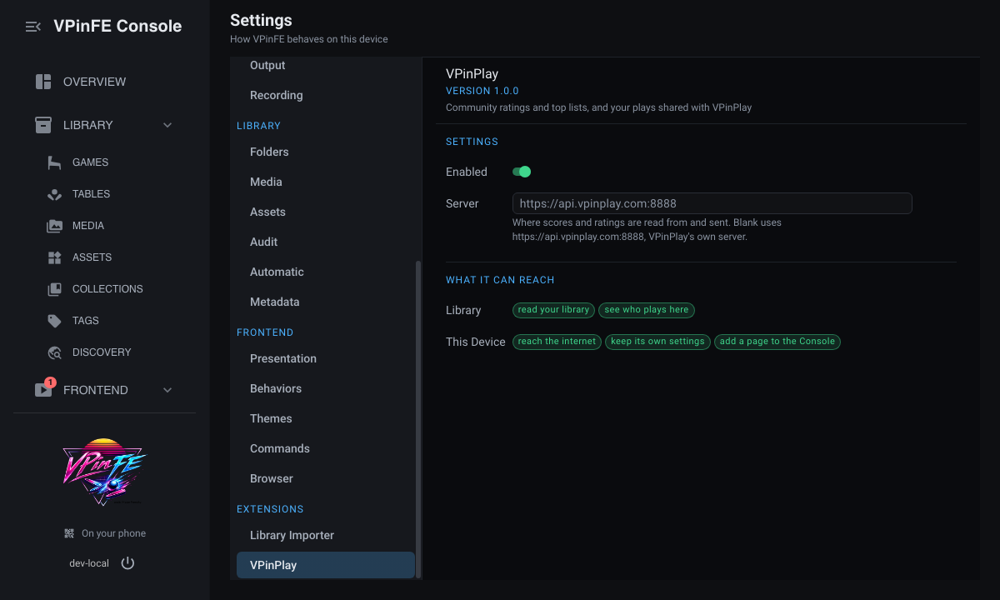

### Write it

There is nothing to write yet.  There are three things to find or start.

- **The practice site.**  It is a few lines of Python playing Example Scores, with three sample
  scores and one key.  Start it in a terminal and leave it running:

  ```bash
  python docs/extensions/examples/practice_site.py
  ```

  It answers on `http://127.0.0.1:8790` and accepts the key `practice-key`.  Stopping it forgets
  whatever you posted.
- **The extensions folder.**  It is `extensions/` under VPinFE's config folder, and
  [Writing an extension](README.md#what-you-need) says where that is on each system.  Make it
  if it is not there.
- **A running VPinFE.**  Open its Console in a browser.

### See it

In the Console, open Settings.  At the bottom of its list is a group called Extensions, and
under it one page for each extension VPinFE has loaded.  The Library Importer and VPinPlay are
there already, because VPinFE ships them.  Yours will join them.

### Try it

Open `http://127.0.0.1:8790/top` in a browser.  The site answers that the key was not accepted,
because the browser sent none.  That refusal is what lesson 3 turns into a sentence on a page.

### What core did

Nothing of yours has run yet, so core has done only its own part: it looked in the extensions
folder, found nothing there, and drew the pages for the two extensions it ships.  Where an
extension's page appears is core's choice, not the extension's.  The Extensions group is where
every extension is switched on and off, set up and read about, whoever wrote it.

### If it does not show

- **The practice site says the address is in use.**  Something else holds port 8790.  Stop it, or
  stop the other copy of the site.
- **There is no Extensions group.**  Scroll the list of Settings pages; it is the last group.

## Lesson 1: An extension that loads

**What you'll have:** an extension VPinFE knows about, that does nothing yet.

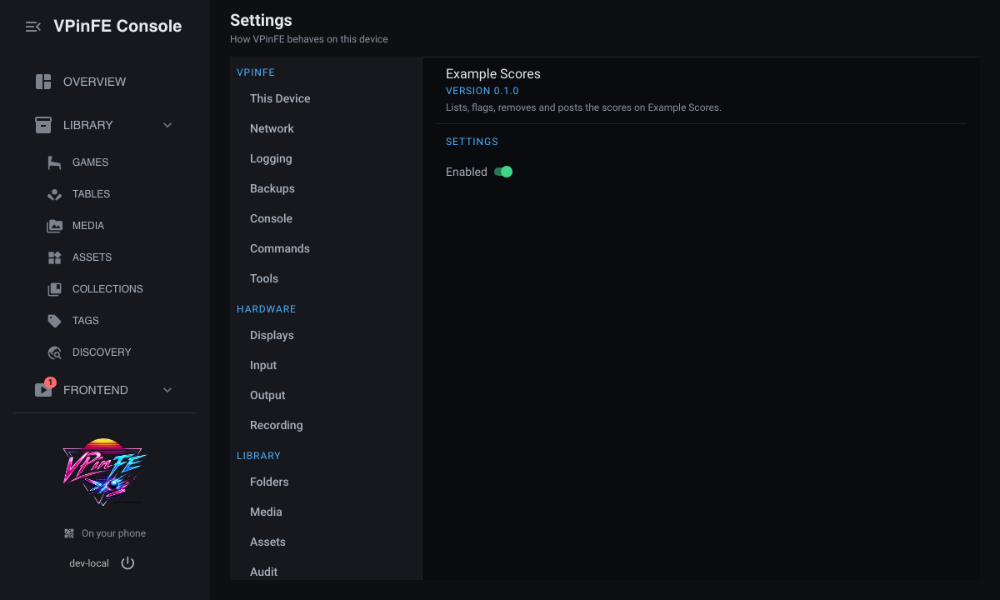

### Write it

Make a folder called `example_scores` in your extensions folder.  An extension has three files.

The manifest is the first thing VPinFE reads.  It names the extension, gives its version, and
says which version of the extension platform it was written for.

`scores/01-loads/example_scores/extension.json`

```json
{
  "name": "example_scores",
  "version": "0.1.0",
  "requires_platform": 1
}
```

The `name` is how VPinFE tells it from every other extension, and it has to be the folder's name
too.  `requires_platform` is a promise about the shape of the calls you are about to make.

The package is a function, `register`, that core calls once with a `ctx` in its hand.  Everything
an extension gives VPinFE, it gives through `ctx`.

`scores/01-loads/example_scores/__init__.py`

```python
def register(ctx):
    ctx.logger.info("%s", ctx.t("log.started"))
```

`ctx.logger` is this extension's own line in the log, and `ctx.t` finds its words.  The words are
the third file.

`scores/01-loads/example_scores/i18n/en.json`

```json
{
  "name": "Example Scores",
  "description": "Lists, flags, removes and posts the scores on Example Scores.",
  "log.started": "Example Scores started"
}
```

`name` and `description` are what the Extensions page shows.  Every other word the extension
ever shows is in this file too, under a key it chooses, and `ctx.t("log.started")` is looked up
here.  Nothing in `__init__.py` is a sentence a person reads.

### See it

Restart VPinFE.  Open Settings, then Extensions, then Example Scores.  The extension is not
running yet: VPinFE did not ship it, so it waits for you to accept it.  Press Accept, read the
prompt, and accept.  The page then shows the name, the version and the description, and one
switch, Enabled.  The switch is on.  Accepting an extension you wrote
yourself is the same step a person takes with yours.

Without starting VPinFE you can ask what it would make of the folder:

```bash
./vpinfe --check-extension path/to/example_scores
```

It loads the extension the way VPinFE does, in a scratch place that is thrown away, and says what
it declared:

```text
loads      example_scores 0.1.0
```

It sends nothing and changes nothing.  It exits with 1 when something would not pass, so you can
run it from a script.

### Try it

Break it on purpose, and find where the break is reported.  In `__init__.py`, rename `register`
to `start`.  Then switch the extension off and on again on its page.  The page now says the
extension failed, with the reason: "The log says why it did not start - TypeError: its package
defines no register(ctx)".  The same reason is the last line of the check, after `fails`.  Put
the name back, and switch the extension off and on again to load it.

### What core did

- **It found the extension.**  Core looks in the extensions folder at startup, reads each
  manifest, and loads the ones it can.  One that cannot be loaded costs that extension and no
  other, and says why on its page.  See [load, off and on, reload](how-it-works.md#load-off-and-on-again-and-reload).
- **It drew the page.**  You wrote a name and a description.  The page, the switch and the version
  line are core's.  See [what core draws and what you supply](how-it-works.md#what-core-draws-and-what-you-supply).
- **It ran your code inside VPinFE.**  There is no separate process, so there is no sandbox:
  loading an extension is trusting it.  See [one process](how-it-works.md#one-process-so-accepting-is-trusting).
- **It found the words.**  A catalog key is the extension's name, a dot, and the key you chose, so
  yours cannot collide with another's.  See [words and languages](how-it-works.md#words-and-languages).

### If it does not show

- **The page says the folder has to be called what the manifest says.**  "Its manifest calls it
  example_scores, so its folder has to be called that too".  Rename the folder.
- **The page says the log shows why.**  The reason follows it, and the traceback is in the log.  A
  missing `register` reads "its package defines no register(ctx)".
- **The check names a word.**  A line starting `missing` is a catalog key the extension uses and
  its `en.json` does not have.  Take out `description`, and it reads
  `missing    ext.example_scores.description - the extension's description`.
- **Nothing changed after an edit.**  A folder that is new, a manifest and a word each need a
  restart of VPinFE.  Edited code needs the extension switched off and on again.

## Lesson 2: Settings

**What you'll have:** a page of settings for a site address and a key, that refuses an address
that is not one.

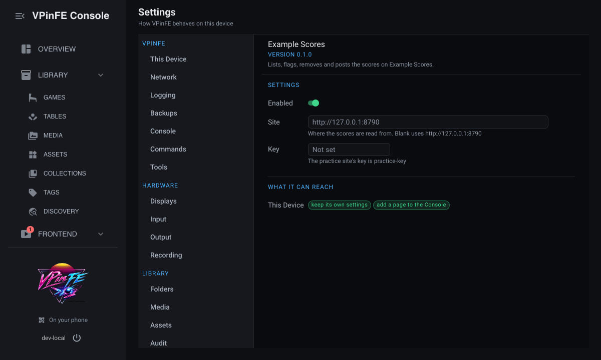

### Write it

Two things change in the manifest: the extension now says it keeps settings of its own and adds
to the Console.

`scores/02-settings/example_scores/extension.json`

```json
{
  "name": "example_scores",
  "version": "0.1.0",
  "requires_platform": 1,
  "capabilities": [
    "config:own",
    "ui:mount"
  ]
}
```

`config:own` is where it keeps what the person types.  `ui:mount` is the right to add anything to
the Console, and every call on `ctx.ui` needs it.

Next, in `register`, the settings themselves.

`scores/02-settings/example_scores/__init__.py` (lines 4-11)

```python
    def check(values):
        if not values["site"].startswith(("http://", "https://")):
            raise ValueError(ctx.t("error.address"))

    ctx.ui.settings([
        {"key": "site", "type": "string", "default": "http://127.0.0.1:8790"},
        {"key": "key", "type": "secret"},
    ], check=check)
```

A setting is a key, a kind and, if it has one, a default.  `site` is a plain string that starts
as the practice site's address.  `key` is a `secret`, which core draws as a field that hides what
is typed and never shows back.  `check` runs when the person changes something, and raising
`ValueError` refuses the change with your words.

The words are the labels, the help and the refusal.

`scores/02-settings/example_scores/i18n/en.json` (lines 4-9)

```json
  "log.started": "Example Scores started",
  "settings.site.label": "Site",
  "settings.site.help": "Where the scores are read from.  Blank uses {default}",
  "settings.key.label": "Key",
  "settings.key.help": "The practice site's key is practice-key",
  "error.address": "The address must start with http:// or https://"
```

The key `settings.site.label` is the label under `site`.  `{default}` in the help is filled in by
core with the default you gave, so the text and the setting cannot drift apart.  The first line
is the line you already had, now ending in a comma.

### See it

Restart VPinFE, because the manifest changed.  Open Settings, then Extensions, then Example
Scores.  There is a Site field with the practice site's address and a Key field.  Type
`practice-key` into Key.

### Try it

Break the check on purpose.  Replace the address with `nope` and press Enter.

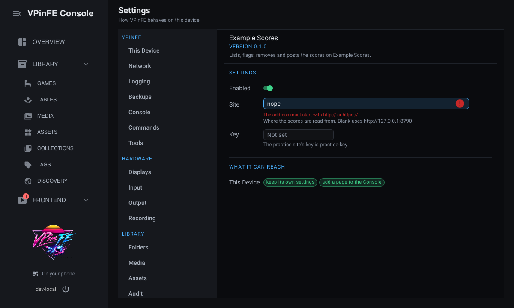

The change is refused and the reason is under the field you changed: "The address must start with
http:// or https://".  Nothing was written.  Put the address back.

### What core did

- **It drew the form.**  A field's kind decides what is drawn, so you declared a `secret` and did
  not build a password field.  Core drew the label, the help and the refusal, and it keeps the
  value.  See [what core draws and what you supply](how-it-works.md#what-core-draws-and-what-you-supply).
- **It kept the secret secret.**  A `secret` is never sent back to the page, so what the person
  typed cannot be read from it.  See [Good extensions](good-extensions.md#secrets).
- **It kept the settings in a file of the extension's own.**  Not in VPinFE's, so one extension's
  bad file costs that extension.  See [where an extension's data lives](how-it-works.md#where-an-extensions-data-lives).

### If it does not show

- **There is no Site field.**  Without `ui:mount` the extension fails to start, and the check
  says "offers settings, which needs the ui:mount capability its manifest does not declare".
- **The check names a setting's label.**  `missing    ext.example_scores.settings.key.label - a setting's label`
  means the label is not in `en.json`.
- **The page will not draw a kind.**  A setting of kind `password` fails with a line that lists
  what a settings page draws: multi, number, path, secret, select, string, switch.

## Lesson 3: A list in Community

**What you'll have:** a page of the site's scores in the Community part of the rail, with a
player, a table and a score for each.

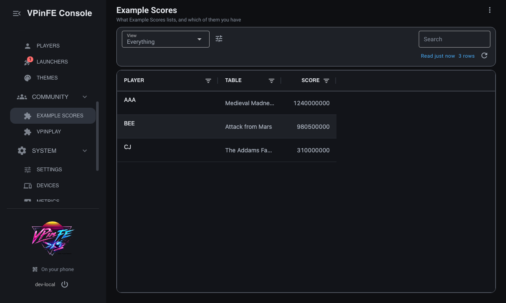

### Write it

The list needs to call the site, so the manifest asks for the network too.

`scores/03-list/example_scores/extension.json`

```json
{
  "name": "example_scores",
  "version": "0.1.0",
  "requires_platform": 1,
  "capabilities": [
    "config:own",
    "ui:mount",
    "net:outbound"
  ]
}
```

The first new piece is the small helper that talks to the site.  The imports come first.

`scores/03-list/example_scores/__init__.py` (lines 1-5)

```python
import json
import urllib.error
import urllib.request

from common.extensions.contract import Unavailable
```

Then `call`, which every later lesson reuses.

`scores/03-list/example_scores/__init__.py` (lines 20-33)

```python
    def call(path, method="GET", body=None):
        request = urllib.request.Request(
            ctx.config.get("site").rstrip("/") + path, method=method,
            data=json.dumps(body).encode() if body is not None else None,
            headers={"X-API-Key": ctx.config.get("key"), "Content-Type": "application/json"})
        try:
            with urllib.request.urlopen(request, timeout=10) as answer:
                return json.loads(answer.read())
        except urllib.error.HTTPError as exc:
            if exc.code == 401:
                raise Unavailable(ctx.t("error.refused")) from exc
            raise Unavailable(ctx.why(exc, at=request.full_url)) from exc
        except OSError as exc:
            raise Unavailable(ctx.why(exc, at=request.full_url)) from exc
```

It sends the key the person typed in, reads the JSON that comes back, and turns each way it can
fail into `Unavailable`, with words.  A wrong key is the one failure with a sentence of its own,
and any other is `ctx.why`, which words the cause the way core's own pages do.

The list is the rows, the columns and one call.

`scores/03-list/example_scores/__init__.py` (lines 35-44)

```python
    def rows():
        return call("/top")

    columns = [
        {"field": "player"},
        {"field": "table"},
        {"field": "score", "kind": "number"},
    ]

    ctx.ui.list("scores", rows, area="community", columns=columns)
```

`rows` hands core the rows as it finds them.  `columns` names the field each column reads, and
`score` says it is a number so it sorts as one.  `ctx.ui.list` gives the list a key and puts it
in an area of the rail.  The areas are `library`, `frontend`, `community` and `system`.

The words are the title and the three headers.

`scores/03-list/example_scores/i18n/en.json` (lines 9-14)

```json
  "error.address": "The address must start with http:// or https://",
  "error.refused": "The site did not accept the key",
  "list.scores.title": "Example Scores",
  "list.scores.column.player.header": "Player",
  "list.scores.column.table.header": "Table",
  "list.scores.column.score.header": "Score"
```

### See it

Restart VPinFE.  Under Community in the rail there is now Example Scores.  Before you give the
Key setting a value the page says the site did not accept the key, and with `practice-key` in
place it lists three scores.

### Try it

Change the key to something else.  Press the refresh button on the list.  The page says the
site did not accept the key, in your sentence, and the list is empty.  Core asked `rows` again,
and `rows` told it what happened.

### What core did

- **It wrote the page, the route and the sorting.**  You gave it rows and column names.  Clicking
  a header to sort, the search box and the refresh button are core's.  See [what core draws and
  what you supply](how-it-works.md#what-core-draws-and-what-you-supply).
- **It asked every time.**  Core calls `rows` when the person opens or refreshes the page, so
  answer with the whole list as it is now and keep no copy of your own.
- **It turned a failure into a sentence.**  `Unavailable` is served as "could not reach its
  service", with your words under it.  The extension keeps running and the next visit asks again.
  See [Running one](reference/running.md#unavailable).
- **It checked the check.**  `--check-extension` calls `rows` with no key set, since it runs in a
  scratch place, so it reports "could not reach its service - The site did not accept the key"
  and still passes.  It shows that a read was answered, not that the site was reached.

### If it does not show

- **The page says the site did not accept the key.**  The Key setting is empty or wrong.
- **The extension failed to start with a line about the list.**  A column with no `field`, or a
  list with no key, reads "declares a list with no key or a column with no field".
- **The list is there with the wrong title.**  The title is a word, `list.scores.title`.  A list
  may not be titled as one of VPinFE's own pages, and two lists in one area may not share a title.

## Lesson 4: A list that reads well

**What you'll have:** the list with the game drawn the way the Games page draws it, a date, a
colored status, two views and a line saying where the scores came from.

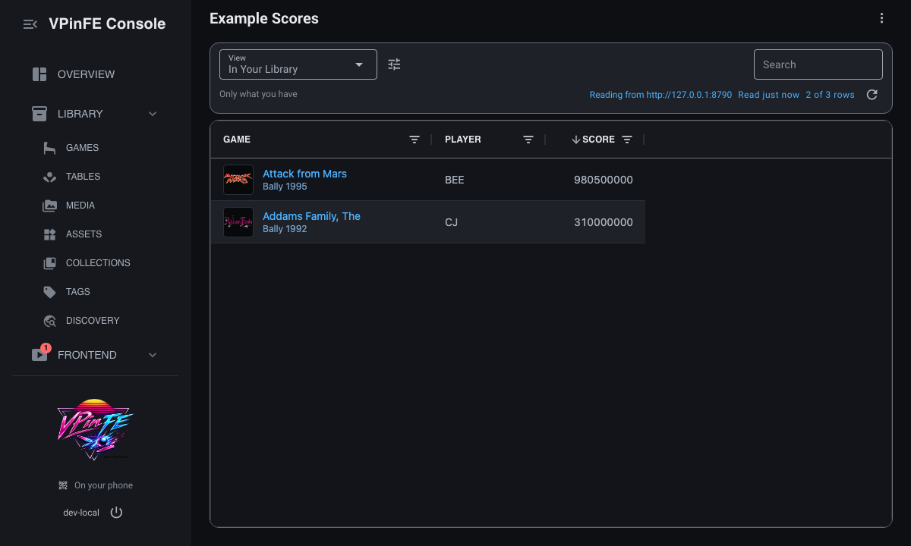

### Write it

The columns change.  The table becomes a game, and two more columns arrive.

`scores/04-reads-well/example_scores/__init__.py` (lines 38-47)

```python
    columns = [
        {"field": "vps_id", "kind": "game", "name_from": "table"},
        {"field": "player"},
        {"field": "score", "kind": "number"},
        {"field": "posted", "kind": "date"},
        {"field": "status", "kind": "state", "states": {
            "verified": {"tier": "on"},
            "pending": {"tier": "warn"},
        }},
    ]
```

`vps_id` holds an id from the Virtual Pinball Spreadsheet, and `kind: game` tells core to draw
what that id names, as Games does: the picture, the name, the maker and the year, and the name as
a link to the game.  The first column is the row's name, which core calls the identifier, so core also relates each row to
your library by it.  `name_from` names the row field to draw where neither your library nor the
spreadsheet knows the id.  `posted` is a date and sorts by time.  `status` is a state: a word
from a short list you declare, and the tier says how loud it is.

The views are the orderings a person can pick.

`scores/04-reads-well/example_scores/__init__.py` (lines 49-53)

```python
    views = [
        {"key": "best", "columns": ["vps_id", "player", "score"],
         "sort": [{"field": "score", "desc": True}], "ranks": True},
        {"key": "newest", "sort": [{"field": "posted", "desc": True}]},
    ]
```

Each view names the columns it shows, and how it sorts.  `best` shows three of them, highest
score first.  `ranks` offers that order to collections, so a collection can be put in the order
of the best scores.  Core allows it when the identifier is a game or table and the sort is on a
number or a date.  `newest` names no columns, so it shows all of them, latest first.

The status line is a sentence above the list.

`scores/04-reads-well/example_scores/__init__.py` (lines 55-56)

```python
    def status():
        return {"text": ctx.t("status.site", site=ctx.config.get("site")), "to": "settings"}
```

It returns the text, and `to` turns it into a link to this extension's page in Settings.

The new words are a header for each new column, a word for each state, and the views'.

`scores/04-reads-well/example_scores/i18n/en.json` (lines 13-23)

```json
  "list.scores.column.score.header": "Score",
  "list.scores.column.vps_id.header": "Game",
  "list.scores.column.posted.header": "Posted",
  "list.scores.column.status.header": "Status",
  "list.scores.column.status.state.verified": "Verified",
  "list.scores.column.status.state.pending": "Pending",
  "list.scores.column.status.state.pending.why": "The site has not checked it yet",
  "list.scores.view.best.name": "Best",
  "list.scores.view.best.help": "Highest first, and an order for a collection",
  "list.scores.view.newest.name": "Newest",
  "status.site": "Reading from {site}"
```

A state's word is required, and a tooltip, the line ending `.why`, is optional.

### See it

Refresh the list.  The View menu above the grid now has three entries, and the first is In Your
Library.  Core adds it whenever the identifier is a game: it is your first view with only the
rows whose game your library holds.  Pick Best, and every score shows, whether or not you have
the game.

### Try it

Pick Best.  Medieval Madness is in the list and is not in your library, so it has no picture and
no link, and it is named by what `name_from` pointed at: the row's `table`.  Take `name_from` out of the
column and it is drawn as its id instead.

### What core did

- **It drew the game.**  You gave it an id.  Core looked the id up in your library and in the
  spreadsheet, chose the picture the Thumbnails setting asks for, and linked the name to the
  game.  See [what core draws and what you supply](how-it-works.md#what-core-draws-and-what-you-supply).
- **It chose the colors.**  A tier is a level, and the colors are the Console's own, so a state
  reads the same here as on every other page.  See [Good extensions](good-extensions.md#words-and-marks).
- **It added the view that relates the list to your library.**  A person asks "which of these do I
  have?" and the answer is the first view.
- **It filtered and sorted by what is drawn.**  A game column is sorted by the name it shows, and
  a state column is filtered by its words.

### If it does not show

- **The check names a state.**  `missing    ext.example_scores.list.scores.column.status.state.pending - a state's word`
  means a state has no word in `en.json`.
- **A view is refused.**  "declares a view with no key or on a column it does not have" means a
  view names a column the list does not.
- **A state's tier is refused.**  A tier is one of bad, off, on, unknown or warn.  The reason
  names the one you wrote.

## Lesson 5: The title menu

**What you'll have:** a menu at the end of the list's title with two entries: one opens the site,
one checks the key.

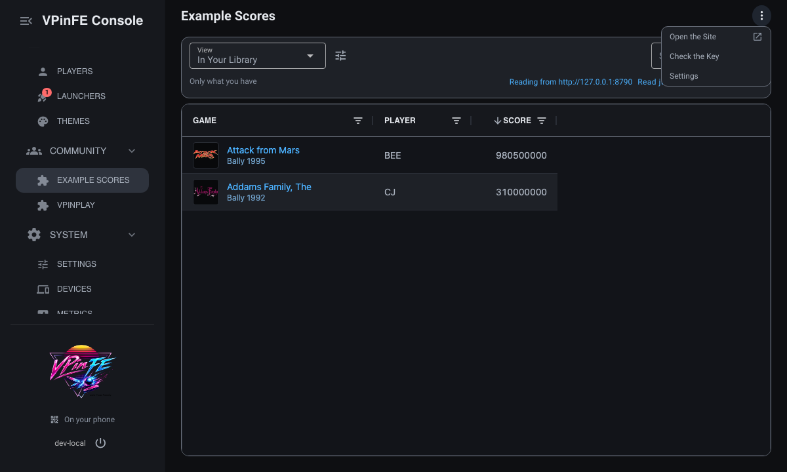

### Write it

An act is something to do that is not about one row.  Core gives them a menu at the end of the
title.

`scores/05-title-menu/example_scores/__init__.py` (lines 58-69)

```python
    def test():
        call("/check")
        return ctx.t("message.accepted")

    def acts():
        found = {"site": ctx.config.get("site")}
        if ctx.config.get("key"):
            found["test"] = test
        return found

    ctx.ui.list("scores", rows, area="community", columns=columns, views=views, status=status,
                acts=acts)
```

`acts` returns a dictionary of acts, and an act is either a function or an address.  `site` is an
address, so core opens it in a new tab and marks the entry as leaving, and your code is not
called at all.  `test` is a function, so pressing it calls it.  What it returns is said to the
person, and a failure it raises is said instead.  `acts` is itself a function, because core
calls it each time the page opens and after each act, so you can offer an act only while it can
work.  Without a key there is nothing to check, so the entry is not there.

The words are the labels and the answer.

`scores/05-title-menu/example_scores/i18n/en.json` (lines 23-26)

```json
  "status.site": "Reading from {site}",
  "list.scores.act.site.label": "Open the Site",
  "list.scores.act.test.label": "Check the Key",
  "message.accepted": "The site accepted the key"
```

### See it

Open the list and press the three dots at the end of its title.  The menu has Open the Site, Check
the Key, and Settings, which core adds after yours wherever an extension has settings.  Open the
Site opens the practice site in a new tab.  Check the Key says "The site accepted the key".

### Try it

Change the Key setting to something else and press Check the Key again.  It says "The site did not
accept the key", in the words `call` raised.  Put `practice-key` back.

### What core did

- **It ran the act for you.**  It called `test`, said what came back and said what went wrong
  if it did.  You wrote no route and no gate for the press.  See [what core draws and what you
  supply](how-it-works.md#what-core-draws-and-what-you-supply).
- **It kept an address from leaving silently.**  An entry that goes elsewhere is marked as
  leaving, and one that does not start with `http://` or `https://` is left out.
- **It put Settings in the menu.**  Wherever an extension has settings, the person can reach them
  from its list.

### If it does not show

- **Check the Key is not in the menu.**  The key is empty, so `acts` did not offer it.  Set the key
  and open the page again.
- **Open the Site is not in the menu.**  An address that does not start with `http://` or
  `https://` is left out, with no error.
- **An entry has the key for its name.**  The label is `list.scores.act.<act>.label`, and without
  it core falls back to the act's key.

## Lesson 6: Acting on rows

**What you'll have:** three things to do to a score: open it on the site, flag it, and remove it.

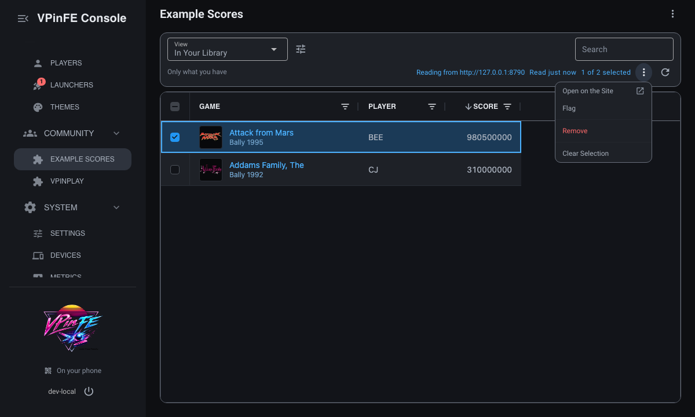

### Write it

A verb works on rows, so the rows have to carry what the verbs need.  Each row gets the address
of its page and a true-or-false field, `can_flag`.

`scores/06-rows/example_scores/__init__.py` (lines 35-38)

```python
    def rows():
        site = ctx.config.get("site").rstrip("/")
        return [{**one, "page": f"{site}/scores/{one['id']}", "can_flag": not one["flagged"]}
                for one in call("/top")]
```

Each verb that changes something is a function that is handed the rows picked.

`scores/06-rows/example_scores/__init__.py` (lines 70-77)

```python
    def flag(picked):
        for one in picked:
            call(f"/scores/{one['id']}/flag", "POST")
        return ctx.t("message.flagged", count=len(picked))

    def remove(picked):
        for one in picked:
            call(f"/scores/{one['id']}", "DELETE")
```

The two verbs are declared in one list.

`scores/06-rows/example_scores/__init__.py` (lines 79-83)

```python
    verbs = [
        {"key": "open", "link": "page"},
        {"key": "flag", "run": flag, "needs": "can_flag"},
        {"key": "remove", "run": remove, "danger": True},
    ]
```

`open` is a link: its `link` is the row field holding an address, so core opens it in a new tab
and does not call you.  `flag` is a function that `needs` `can_flag`, so on a row where that is
false the verb is grey, with a reason.  `remove` is `danger`: it goes last, in red, and asks first.

The list call hands them over.

`scores/06-rows/example_scores/__init__.py` (lines 85-86)

```python
    ctx.ui.list("scores", rows, area="community", columns=columns, views=views, status=status,
                acts=acts, verbs=verbs)
```

The words are each label, the reason Flag is grey, the question Remove asks and the sentence that
follows a flag.

`scores/06-rows/example_scores/i18n/en.json` (lines 26-39)

```json
  "message.accepted": "The site accepted the key",
  "message.flagged": {
    "one": "Flagged the score",
    "other": "Flagged {count} scores"
  },
  "list.scores.verb.open.label": "Open on the Site",
  "list.scores.verb.flag.label": "Flag",
  "list.scores.verb.flag.needs": "Already flagged",
  "list.scores.verb.remove.label": "Remove",
  "list.scores.verb.remove.confirm": {
    "one": "Remove this score from the site?",
    "other": "Remove these {count} scores from the site?"
  }
}
```

### See it

Tick a row's checkbox.  The bar above the grid says how many are selected and a menu appears
beside it.  It lists Open on the Site, Flag, Remove and Clear Selection.  The same menu opens on
a right click of a row.

### Try it

Pick a score and press Flag.  A line says "Flagged the score", the score stays picked, and in the
menu Flag is now grey with "Already flagged" beneath it: the words from `flag.needs`.  The flag is
kept on the site, not in the Console, so the grey comes from the list being read again.

### What core did

- **It drew the menu, in the order that makes sense.**  Verbs that change something come after
  the ones that open, and a `danger` verb is last, under a rule, in red.  See [Good
  extensions](good-extensions.md#where-an-action-sits).
- **It asked for a danger.**  The question is yours, in the catalog, with a singular and a plural so
  it reads right for one row and for several.  See [Good extensions](good-extensions.md#danger-empty-states-and-needs).
- **It checked `needs` twice.**  Once to grey the verb, and again when it is pressed, so a stale
  page cannot make a verb run on a row it is not for.  With several rows picked, the verb is
  grey only when none passes; otherwise it runs on the rows that do and skips the rest.
- **It read the list again.**  After a verb runs, so the page shows what the site says now.

### If it does not show

- **The check names a word.**  `missing    ext.example_scores.list.scores.verb.remove.confirm - the question a danger verb asks`
  and `missing    ext.example_scores.list.scores.verb.flag.needs - why a verb is not for a row`
  are the two words a danger and a `needs` each require.
- **Open on the Site is grey, with No address.**  A link verb needs a row field that starts with
  `http://` or `https://`.  The reason shows when one row is picked.
- **There is no checkbox.**  A row with no `id` shows, but cannot be ticked.

## Lesson 7: Adding a score

**What you'll have:** a plus above the list that posts a score, after asking for the player,
the table and the points and checking them.

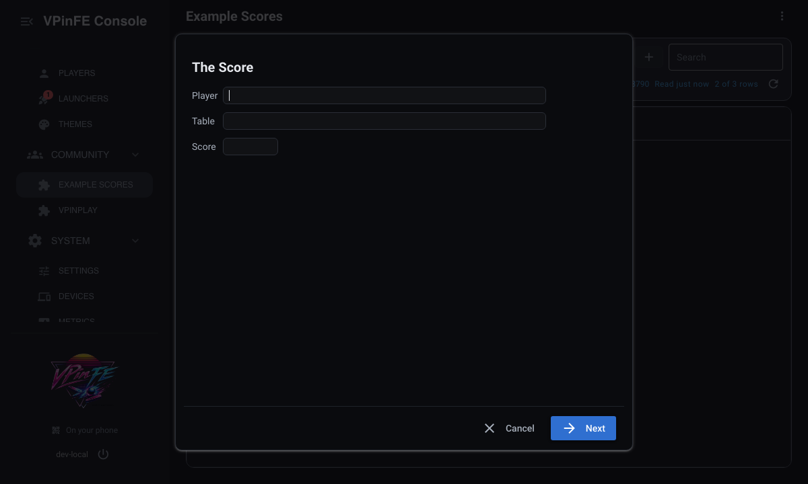

### Write it

A dialog is an object with up to three methods, and core calls each when it is time.

`scores/07-adding/example_scores/__init__.py` (lines 85-112)

```python
    class PostScore:
        def ask(self, step):
            return {"title": ctx.t("dialog.title"),
                    "fields": [
                        {"key": "player", "label": ctx.t("dialog.player"), "type": "string"},
                        {"key": "table", "label": ctx.t("dialog.table"), "type": "string"},
                        {"key": "score", "label": ctx.t("dialog.points"), "type": "number"}]}

        def check(self, values, step):
            needed = ctx.t("dialog.needed")
            errors = {key: needed for key in ("player", "table")
                      if not str(values.get(key) or "").strip()}
            if int(values.get("score") or 0) <= 0:
                errors["score"] = needed
            if errors:
                return {**self.ask(step), "errors": errors}
            return {"title": ctx.t("dialog.sure"),
                    "confirm": ctx.t("dialog.confirm"),
                    "summary": [[ctx.t("dialog.player"), values["player"]],
                                [ctx.t("dialog.table"), values["table"]],
                                [ctx.t("dialog.points"), f"{int(values['score']):,}"]]}

        def run(self, values):
            call("/scores", "POST", {"player": values["player"], "table": values["table"],
                                     "score": int(values["score"])})
            return ctx.t("dialog.posted", table=values["table"])

    ctx.ui.action("post", PostScore())
```

`ask` says what to ask for: a title, and the fields.  `check` is called when Next is pressed.  It
returns either the same step with `errors` that name a field, so the person stays where they are
and is told what is missing, or a step of confirmation, with a `summary` of what will happen and
the word on the button that does it.  `run` is called when that button is pressed.  It does the
thing and returns the sentence to say.  How many steps the dialog has comes from what it answers:
fields mean something to fill in, and a confirm means a step that shows what would happen first.

`add="post"` on the list puts the plus above it.

`scores/07-adding/example_scores/__init__.py` (lines 114-115)

```python
    ctx.ui.list("scores", rows, area="community", columns=columns, views=views, status=status,
                acts=acts, verbs=verbs, add="post")
```

The words are the title, the labels, the refusal and the confirmation.

`scores/07-adding/example_scores/i18n/en.json` (lines 39-47)

```json
  "action.post.label": "Post a Score",
  "dialog.title": "The Score",
  "dialog.player": "Player",
  "dialog.table": "Table",
  "dialog.points": "Score",
  "dialog.needed": "This is needed",
  "dialog.sure": "Post this score?",
  "dialog.confirm": "Post",
  "dialog.posted": "Posted a score for {table}"
```

`action.post.label` names the dialog wherever core offers it, and `{table}` in the last line is
filled by the `table=` you passed.

### See it

Press the plus above the list.  A dialog asks for the player, the table and the score.  Fill them
in and press Next.  The second step shows what will be posted, and its button reads Post.  Press
it and the list shows the new score.

### Try it

Press Next with the fields empty.  The dialog stays on the first step and "This is needed" shows
under each empty field.  `check` answered with `errors`, and nothing went to the site.

### What core did

- **It drew the dialog.**  The frame, the buttons and the way forward and back are core's, so the
  dialog looks like every other one in the Console.  See [what core draws and what you
  supply](how-it-works.md#what-core-draws-and-what-you-supply).
- **It chose the number of steps.**  You never declare one.  What `ask` and `check` answer decides it.
- **It put the errors where they belong.**  A reason keyed by a field is drawn under that field.
- **It read the list again.**  After `run` returns, so the new score shows.

### If it does not show

- **The extension fails to start with a line about posting.**  `add` names a dialog that is
  not declared: "opens, from the list 'scores', an action it never offers: posting".  Make the
  names the same.
- **There is no plus.**  The list has no `add`.
- **Posting says the site did not accept the key.**  The Key setting is wrong; `call` raised it, and
  `run` let it through, so it is said.

## Lesson 8: The detail pane

**What you'll have:** a pane that opens beside the list when you click a score, with the facts about
it and a note of your own.

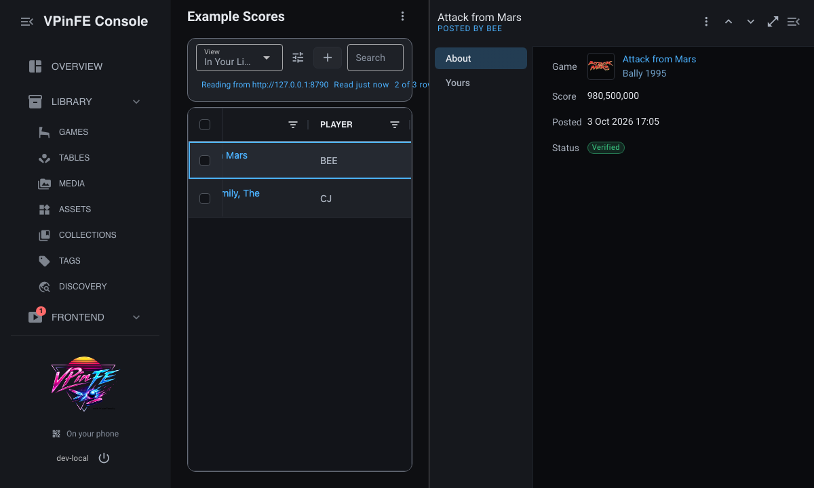

### Write it

A pane is two functions and a word on the list.  `detail` is called with a row's `id` and answers
what to show.

`scores/08-pane/example_scores/__init__.py` (lines 114-131)

```python
    def detail(row_id):
        one = next((one for one in call("/top") if one["id"] == row_id), None)
        if one is None:
            return None
        return {
            "title": one["table"],
            "under": ctx.t("pane.under", player=one["player"]),
            "sections": [
                {"key": "about", "label": ctx.t("pane.about"), "facts": [
                    {"label": ctx.t("pane.game"), "kind": "game", "value": one["vps_id"],
                     "says": one["table"]},
                    {"label": ctx.t("pane.score"), "kind": "number",
                     "value": f"{one['score']:,}"},
                    {"label": ctx.t("pane.posted"), "kind": "date", "value": one["posted"]},
                    {"label": ctx.t("pane.status"), "kind": "state",
                     "value": ctx.t(f"pane.status.{one['status']}"),
                     "tier": "on" if one["status"] == "verified" else "warn"},
                ]},
```

It answers a title, the line under it, and sections.  A section holds facts, which are read-only,
or fields, which a person can change, and each fact has a kind that tells core how to draw it.
The kinds are the same as a column's, so `game` draws the game as the list does, a `number` is
right-aligned and a `state` has a tier.

The second section is the one a person can change.

`scores/08-pane/example_scores/__init__.py` (lines 132-137)

```python
                {"key": "mine", "label": ctx.t("pane.mine"), "fields": [
                    {"key": "note", "type": "string", "label": ctx.t("pane.note"),
                     "value": ctx.config.get(f"note.{row_id}")},
                ]},
            ],
        }
```

`save` is called with the row's `id` and the values of the section's fields.

`scores/08-pane/example_scores/__init__.py` (lines 139-140)

```python
    def save(row_id, values):
        ctx.config.set(f"note.{row_id}", values["note"] or "")
```

The note is kept in the extension's own settings file, under a name that holds the row's id.  The
list call names the two.

`scores/08-pane/example_scores/__init__.py` (lines 142-143)

```python
    ctx.ui.list("scores", rows, area="community", columns=columns, views=views, status=status,
                acts=acts, verbs=verbs, add="post", detail=detail, save=save)
```

The words are the title's second line, each section and each label.

`scores/08-pane/example_scores/i18n/en.json` (lines 48-57)

```json
  "pane.under": "Posted by {player}",
  "pane.about": "About",
  "pane.game": "Game",
  "pane.score": "Score",
  "pane.posted": "Posted",
  "pane.status": "Status",
  "pane.status.verified": "Verified",
  "pane.status.pending": "Pending",
  "pane.mine": "Yours",
  "pane.note": "Note"
```

### See it

Click a score's player, not its checkbox.  The pane opens beside the list with the player under the
title.  About has the game with its picture, the score, when it was posted and its status.  Yours has a field
for a note.

### Try it

Type something in Note.  There is no button: core calls `save`.  Close the pane, open the same
score again and the note is still there.

### What core did

- **It drew the pane.**  The frame, the sections, the way between rows and the way to widen it are
  core's.  You answered with what to show.  See [what core draws and what you
  supply](how-it-works.md#what-core-draws-and-what-you-supply).
- **It drew each fact by its kind.**  A game, a date, a state and a number each look as they do
  everywhere else in the Console.
- **It saved for you.**  A field has no save button of its own: core calls `save` and the value
  is yours to keep.  Settings you declared are saved by core, but a field in a pane is for data
  the extension keeps itself.  See [where an extension's data lives](how-it-works.md#where-an-extensions-data-lives).
- **It asked `detail` for the one row.**  It does not ask for every row.

### If it does not show

- **Clicking a row opens nothing.**  The list has no `detail`.  The check says `opens a pane` on
  the list line only when it has.
- **The pane says Example Scores no longer has the row.**  `detail` returned None for the id, as it
  does when the site no longer has the score.
- **The pane shows an error that names a kind.**  A fact with a kind that core does not draw is
  refused when the pane opens, not when the extension starts: "Example Scores's pane for s2: About
  fact has kind numeric; drawn kinds: text, number, date, state, chips, link, picture, game,
  table".  The extension keeps running, so the rest of the list still works.
- **The check cannot read the pane.**  It runs with no key, so `detail` is not called.  The pane
  is the one thing in this lesson you only see by opening it.

## Lesson 9: A group on a game's panel

**What you'll have:** the best score and the number of scores on the game's own panel in the
Games page, and a line in the log when a game ends.

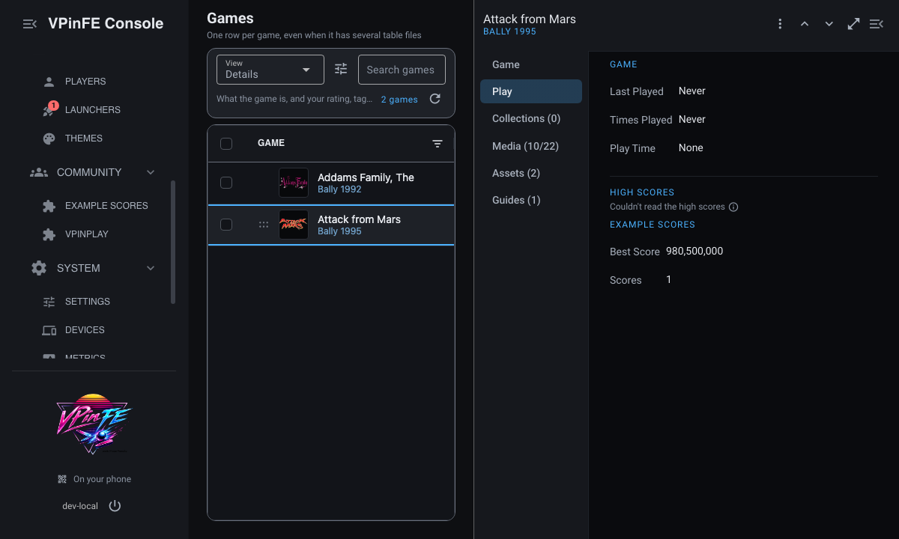

### Write it

A group is a section the extension adds to a game's panel.  It needs one new thing in the
manifest: asking to read the library.

`scores/09-panel-group/example_scores/extension.json`

```json
{
  "name": "example_scores",
  "version": "0.1.0",
  "requires_platform": 1,
  "scopes": [
    "games:read"
  ],
  "capabilities": [
    "config:own",
    "ui:mount",
    "net:outbound"
  ]
}
```

`games:read` is a scope.  The extension's page lists it in words, so a person installing it can see
that it reads the library.  A group asks to know which game it is on, and without the scope that is
refused.

`read` is called with the game it is for.

`scores/09-panel-group/example_scores/__init__.py` (lines 145-156)

```python
    def game_group(who):
        if not who["vps_id"]:
            return None
        scores = [one["score"] for one in call("/top") if one["vps_id"] == who["vps_id"]]
        if not scores:
            return None
        return {"facts": [
            {"label": ctx.t("group.best"), "kind": "number", "value": f"{max(scores):,}"},
            {"label": ctx.t("group.count"), "kind": "number", "value": str(len(scores))},
        ]}

    ctx.ui.panel_group("game", game_group, section="play")
```

`who` is the game's ids and name.  The group answers one section, the same facts a pane's section
holds, or None to be left out.  A game with no scores answers None, so there is no group at all
rather than an empty one.  The word for its title is in the catalog.

`scores/09-panel-group/example_scores/i18n/en.json` (lines 58-65)

```json
  "group.game.title": "Example Scores",
  "group.best": "Best Score",
  "group.count": "Scores",
  "log.played": {
    "one": "{game} was played for a minute",
    "other": "{game} was played for {count} minutes"
  }
}
```

An extension can also hear that something happened.  Core says so when a game ends, and the extension
asks to be told.

`scores/09-panel-group/example_scores/__init__.py` (lines 158-163)

```python
    def played(game_id="", seconds=0, private=False, **_rest):
        if private:
            return
        ctx.logger.info("%s", ctx.t("log.played", game=game_id, count=round(seconds / 60)))

    ctx.events.subscribe("table.play_recorded", played)
```

The handler is given what core says about the game.  `private` says whether the game is Private,
and a Private game is left alone.

### See it

Restart VPinFE and open the Games page.  Pick Attack from Mars and the Play section.  After High
Scores is a heading, Example Scores, with the best score and how many scores there are.  The Addams
Family has one too.  A game that has no scores, or that the site does not know, has no group.

### Try it

Remove the score for Attack from Mars on the practice site, then open the game's Play section
again.  The group is gone.  `game_group` asked the site, found no score for the game and answered
None.

### What core did

- **It put the group where a person looks.**  At the end of Play, drawn the way the rest
  of the panel is.  You named a game and a function.  See [what core draws and what you
  supply](how-it-works.md#what-core-draws-and-what-you-supply).
- **It never asked about a Private game.**  When somebody marks a game Private, core does not call
  your `read` for it.  The extension is not told the library holds the game.  An extension can
  read the flag, from an event or from `ctx.games`, and can never set it.  See [Private games never
  leave](how-it-works.md#private-games-never-leave).
- **It checked the scope.**  Without `games:read` the extension fails at start with "offers a panel
  group, which needs games:read, and its manifest does not declare it".  See [scopes and
  tiers](how-it-works.md#scopes-and-tiers).
- **It handed the event over.**  `table.play_recorded` arrives once the game has ended and its play
  is written.  It carries `private`, which is why the handler returns first when it is true.

### If it does not show

- **The extension fails to start.**  The message names `games:read`.  Add it to `scopes`, which is
  the manifest's list of what the extension asks to use, and restart.
- **There is no group.**  The group answered None: the site has no score for the game, the game is
  Private, or the game has no VPS id for the extension to match on.
- **Playing a game writes nothing to the log.**  The extension's log is `vpinfe.ext.example_scores`.
  Look there, and make sure the game is not marked Private.

## Lesson 10: Shipping it

**What you'll have:** a version, a name shown as written, a README, and a clean
`--check-extension`, ready to give to someone.

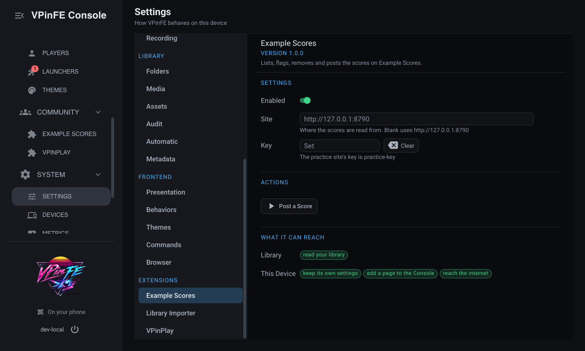

### Write it

The manifest gains a name for people and a version of its own.

`scores/10-shipping/example_scores/extension.json`

```json
{
  "name": "example_scores",
  "display_name": "Example Scores",
  "version": "1.0.0",
  "requires_platform": 1,
  "scopes": [
    "games:read"
  ],
  "capabilities": [
    "config:own",
    "ui:mount",
    "net:outbound"
  ]
}
```

`display_name` is a product name, shown as written in every language, so it is not in the catalog
and `en.json` drops its `name` key.  `version` is shown and never interpreted, so a number you
choose is the number a person sees.  `requires_platform` is the version of the extension platform
the extension was built against, and this build offers 1.  `platforms` is not here because the
extension runs wherever VPinFE does; when one does not, it is a list of `linux`, `windows`,
`macos` or the name of a Linux distribution.

A README tells whoever has the folder what it is, what it asks for and why.  The whole of it is in
the listing below.

### See it

Restart VPinFE.  Open Settings, then Extensions, then Example Scores.  The page shows the name as
written, the version, the description and the settings.  Below them is What It Can Reach.  It lists
what the manifest declares, in words: it reads your library, keeps its own settings, adds a page
to the Console and reaches the internet.  That is the part a person reads before they trust it.

### Try it

Check the whole extension before you give it away.

```bash
./vpinfe --check-extension path/to/example_scores
```

```text
loads      example_scores 1.0.0
settings   site (string, default 'http://127.0.0.1:8790')
settings   key (secret)
list       scores in community: 5 columns, 2 views, 3 verbs, adds post, opens a pane
group      on a game's panel, at the end of play
dialog     post: ask check run
reads      list scores: could not reach its service - Nothing answers at 127.0.0.1
reads      settings: 2 fields
reads      dialog post: first step has 3 fields
```

It does not mind that the practice site is off: a service that is down is not a mistake in the
extension.  Take `display_name` out of the manifest and run it again, and it says
`missing    ext.example_scores.name - the extension's name`, because the name now has to be in the
catalog.  Put it back.

### What core did

- **It listed what the extension asks for.**  The page's What It Says It Uses is the manifest's
  scopes and capabilities in words.  Both are declarations, so the person who installs it can see
  them before it does anything.  See [scopes and tiers](how-it-works.md#scopes-and-tiers).
- **It ran the extension in VPinFE's own process.**  An extension is Python code on the device
  it is installed on, which is why putting a folder in `extensions/` is a decision a person makes.
  See [one process, so accepting is trusting](how-it-works.md#one-process-so-accepting-is-trusting).
- **It marked the extension Unofficial.**  An extension VPinFE did not ship is marked Unofficial and
  stays stopped until the owner accepts it.  Its list of what it asks for is headed "What It Says
  It Uses", because the manifest is the extension's own word.  An update that asks for more stops
  again until the owner accepts the new access.  See
  [the Unofficial mark](how-it-works.md#the-unofficial-mark).

### If it does not show

- **The check says `missing` and names a key.**  A word the extension shows has no entry in
  `i18n/en.json`.  Add it, and restart VPinFE for it to show.
- **The page shows the folder's name, not the product's.**  `display_name` is not in the manifest.
- **The extension does not start on a machine that is not yours.**  Its `platforms` names a system
  that machine is not.  It has no page in Settings, and the log says which platforms it asked for.

## The whole extension

This is lesson 10 in full, ready to put in `extensions/`.

`scores/10-shipping/example_scores/extension.json`

```json
{
  "name": "example_scores",
  "display_name": "Example Scores",
  "version": "1.0.0",
  "requires_platform": 1,
  "scopes": [
    "games:read"
  ],
  "capabilities": [
    "config:own",
    "ui:mount",
    "net:outbound"
  ]
}
```

`scores/10-shipping/example_scores/__init__.py`

```python
import json
import urllib.error
import urllib.request

from common.extensions.contract import Unavailable


def register(ctx):
    ctx.logger.info("%s", ctx.t("log.started"))

    def check(values):
        if not values["site"].startswith(("http://", "https://")):
            raise ValueError(ctx.t("error.address"))

    ctx.ui.settings([
        {"key": "site", "type": "string", "default": "http://127.0.0.1:8790"},
        {"key": "key", "type": "secret"},
    ], check=check)

    def call(path, method="GET", body=None):
        request = urllib.request.Request(
            ctx.config.get("site").rstrip("/") + path, method=method,
            data=json.dumps(body).encode() if body is not None else None,
            headers={"X-API-Key": ctx.config.get("key"), "Content-Type": "application/json"})
        try:
            with urllib.request.urlopen(request, timeout=10) as answer:
                return json.loads(answer.read())
        except urllib.error.HTTPError as exc:
            if exc.code == 401:
                raise Unavailable(ctx.t("error.refused")) from exc
            raise Unavailable(ctx.why(exc, at=request.full_url)) from exc
        except OSError as exc:
            raise Unavailable(ctx.why(exc, at=request.full_url)) from exc

    def rows():
        site = ctx.config.get("site").rstrip("/")
        return [{**one, "page": f"{site}/scores/{one['id']}", "can_flag": not one["flagged"]}
                for one in call("/top")]

    columns = [
        {"field": "vps_id", "kind": "game", "name_from": "table"},
        {"field": "player"},
        {"field": "score", "kind": "number"},
        {"field": "posted", "kind": "date"},
        {"field": "status", "kind": "state", "states": {
            "verified": {"tier": "on"},
            "pending": {"tier": "warn"},
        }},
    ]

    views = [
        {"key": "best", "columns": ["vps_id", "player", "score"],
         "sort": [{"field": "score", "desc": True}], "ranks": True},
        {"key": "newest", "sort": [{"field": "posted", "desc": True}]},
    ]

    def status():
        return {"text": ctx.t("status.site", site=ctx.config.get("site")), "to": "settings"}

    def test():
        call("/check")
        return ctx.t("message.accepted")

    def acts():
        found = {"site": ctx.config.get("site")}
        if ctx.config.get("key"):
            found["test"] = test
        return found

    def flag(picked):
        for one in picked:
            call(f"/scores/{one['id']}/flag", "POST")
        return ctx.t("message.flagged", count=len(picked))

    def remove(picked):
        for one in picked:
            call(f"/scores/{one['id']}", "DELETE")

    verbs = [
        {"key": "open", "link": "page"},
        {"key": "flag", "run": flag, "needs": "can_flag"},
        {"key": "remove", "run": remove, "danger": True},
    ]

    class PostScore:
        def ask(self, step):
            return {"title": ctx.t("dialog.title"),
                    "fields": [
                        {"key": "player", "label": ctx.t("dialog.player"), "type": "string"},
                        {"key": "table", "label": ctx.t("dialog.table"), "type": "string"},
                        {"key": "score", "label": ctx.t("dialog.points"), "type": "number"}]}

        def check(self, values, step):
            needed = ctx.t("dialog.needed")
            errors = {key: needed for key in ("player", "table")
                      if not str(values.get(key) or "").strip()}
            if int(values.get("score") or 0) <= 0:
                errors["score"] = needed
            if errors:
                return {**self.ask(step), "errors": errors}
            return {"title": ctx.t("dialog.sure"),
                    "confirm": ctx.t("dialog.confirm"),
                    "summary": [[ctx.t("dialog.player"), values["player"]],
                                [ctx.t("dialog.table"), values["table"]],
                                [ctx.t("dialog.points"), f"{int(values['score']):,}"]]}

        def run(self, values):
            call("/scores", "POST", {"player": values["player"], "table": values["table"],
                                     "score": int(values["score"])})
            return ctx.t("dialog.posted", table=values["table"])

    ctx.ui.action("post", PostScore())

    def detail(row_id):
        one = next((one for one in call("/top") if one["id"] == row_id), None)
        if one is None:
            return None
        return {
            "title": one["table"],
            "under": ctx.t("pane.under", player=one["player"]),
            "sections": [
                {"key": "about", "label": ctx.t("pane.about"), "facts": [
                    {"label": ctx.t("pane.game"), "kind": "game", "value": one["vps_id"],
                     "says": one["table"]},
                    {"label": ctx.t("pane.score"), "kind": "number",
                     "value": f"{one['score']:,}"},
                    {"label": ctx.t("pane.posted"), "kind": "date", "value": one["posted"]},
                    {"label": ctx.t("pane.status"), "kind": "state",
                     "value": ctx.t(f"pane.status.{one['status']}"),
                     "tier": "on" if one["status"] == "verified" else "warn"},
                ]},
                {"key": "mine", "label": ctx.t("pane.mine"), "fields": [
                    {"key": "note", "type": "string", "label": ctx.t("pane.note"),
                     "value": ctx.config.get(f"note.{row_id}")},
                ]},
            ],
        }

    def save(row_id, values):
        ctx.config.set(f"note.{row_id}", values["note"] or "")

    ctx.ui.list("scores", rows, area="community", columns=columns, views=views, status=status,
                acts=acts, verbs=verbs, add="post", detail=detail, save=save)

    def game_group(who):
        if not who["vps_id"]:
            return None
        scores = [one["score"] for one in call("/top") if one["vps_id"] == who["vps_id"]]
        if not scores:
            return None
        return {"facts": [
            {"label": ctx.t("group.best"), "kind": "number", "value": f"{max(scores):,}"},
            {"label": ctx.t("group.count"), "kind": "number", "value": str(len(scores))},
        ]}

    ctx.ui.panel_group("game", game_group, section="play")

    def played(game_id="", seconds=0, private=False, **_rest):
        if private:
            return
        ctx.logger.info("%s", ctx.t("log.played", game=game_id, count=round(seconds / 60)))

    ctx.events.subscribe("table.play_recorded", played)
```

`scores/10-shipping/example_scores/i18n/en.json`

```json
{
  "description": "Lists, flags, removes and posts the scores on Example Scores.",
  "log.started": "Example Scores started",
  "settings.site.label": "Site",
  "settings.site.help": "Where the scores are read from.  Blank uses {default}",
  "settings.key.label": "Key",
  "settings.key.help": "The practice site's key is practice-key",
  "error.address": "The address must start with http:// or https://",
  "error.refused": "The site did not accept the key",
  "list.scores.title": "Example Scores",
  "list.scores.column.player.header": "Player",
  "list.scores.column.score.header": "Score",
  "list.scores.column.vps_id.header": "Game",
  "list.scores.column.posted.header": "Posted",
  "list.scores.column.status.header": "Status",
  "list.scores.column.status.state.verified": "Verified",
  "list.scores.column.status.state.pending": "Pending",
  "list.scores.column.status.state.pending.why": "The site has not checked it yet",
  "list.scores.view.best.name": "Best",
  "list.scores.view.best.help": "Highest first, and an order for a collection",
  "list.scores.view.newest.name": "Newest",
  "status.site": "Reading from {site}",
  "list.scores.act.site.label": "Open the Site",
  "list.scores.act.test.label": "Check the Key",
  "message.accepted": "The site accepted the key",
  "message.flagged": {
    "one": "Flagged the score",
    "other": "Flagged {count} scores"
  },
  "list.scores.verb.open.label": "Open on the Site",
  "list.scores.verb.flag.label": "Flag",
  "list.scores.verb.flag.needs": "Already flagged",
  "list.scores.verb.remove.label": "Remove",
  "list.scores.verb.remove.confirm": {
    "one": "Remove this score from the site?",
    "other": "Remove these {count} scores from the site?"
  },
  "action.post.label": "Post a Score",
  "dialog.title": "The Score",
  "dialog.player": "Player",
  "dialog.table": "Table",
  "dialog.points": "Score",
  "dialog.needed": "This is needed",
  "dialog.sure": "Post this score?",
  "dialog.confirm": "Post",
  "dialog.posted": "Posted a score for {table}",
  "pane.under": "Posted by {player}",
  "pane.about": "About",
  "pane.game": "Game",
  "pane.score": "Score",
  "pane.posted": "Posted",
  "pane.status": "Status",
  "pane.status.verified": "Verified",
  "pane.status.pending": "Pending",
  "pane.mine": "Yours",
  "pane.note": "Note",
  "group.game.title": "Example Scores",
  "group.best": "Best Score",
  "group.count": "Scores",
  "log.played": {
    "one": "{game} was played for a minute",
    "other": "{game} was played for {count} minutes"
  }
}
```

`scores/10-shipping/example_scores/README.md`

```markdown
# Example Scores

Lists, flags, removes and posts the scores on Example Scores, shows the best score on a
game's panel, and writes a line to its log when a game ends.

Put this folder, `example_scores`, in `extensions/` under the VPinFE config directory.

It asks for:

- `config:own`: it keeps a site address, a key and a note for each score.
- `net:outbound`: it reads and writes the scores on the site.
- `ui:mount`: it adds a list under Community and a group on a game's panel.
- `games:read`: the group on a game's panel needs to know which game it is on.

It runs on every platform VPinFE does.
```

## Where next

Each of these is a small complete extension in the [Cookbook](cookbook.md).

- **Something that takes longer than a press.**  [A long job with progress](cookbook.md#5-a-long-job-with-progress).
- **React to a game, a launch or a score.**  [Listening to events](cookbook.md#6-listening-to-events).
- **A table of things in a list.**  [A list you can add to](cookbook.md#8-a-list-you-can-add-to),
  [acting on rows](cookbook.md#9-acting-on-rows), [states, chips, links and pictures in a
  column](cookbook.md#10-states-chips-links-and-pictures-in-a-column), [a game in a
  list](cookbook.md#11-a-game-in-a-list) and [a pane beside a list](cookbook.md#12-a-pane-beside-a-list).
- **Something per player.**  [An account per player](cookbook.md#13-an-account-per-player).
- **Something on a game.**  [A group on a game's panel](cookbook.md#14-a-group-on-a-games-panel).
- **A page that is not a list.**  [A page of one subject](cookbook.md#16-a-page-of-one-subject) and
  [a page of your own](cookbook.md#17-a-page-of-your-own).
- **Tell the person something needs them.**  [Asking for attention on
  Overview](cookbook.md#18-asking-for-attention-on-overview).
- **One Linux distribution.**  [An extension for one Linux
  distribution](cookbook.md#19-an-extension-for-one-linux-distribution) and [asking the operating
  system to change something](cookbook.md#20-asking-the-operating-system-to-change-something).

Before you give it to anyone, read [Good extensions](good-extensions.md): the habits that make an
extension feel like part of VPinFE, ending in a list to tick.
